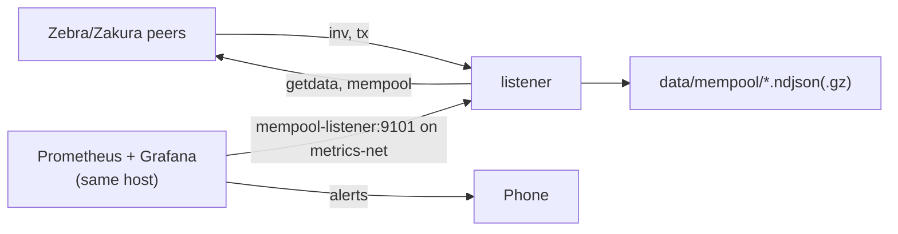

# Mempool listener deployment

The listener runs on the metrics VPS (`metrics.shieldedinfra.net`). It connects to about 50 Zebra and Zakura peers, logs mempool gossip, and exports Prometheus metrics. Grafana on the same host alerts on them.



## Files

| File | Use |
|---|---|
| `compose.yml` | the listener service, on `metrics-net`, capped at 512 MB |
| `Dockerfile` | fetches the release binary |
| `mempool.toml` | listener config and per-tx rule thresholds |
| `wire-upload.sh` | the hourly wire log upload |

The Grafana alert rules live in `ShieldedLabs/shielded-infra` (`workspaces/metrics/grafana/alerting/mempool.yaml`). Its `workspaces/metrics/README.md` lists the host steps.

## Set up

1. Copy this directory to `/root/mempool` on the metrics VPS, and `.env.example` to `.env`.
2. Copy a recent `census-*.ndjson.gz` from the crawler into `data/census/`.
3. Start the listener: `docker compose up -d --build`.
4. Check the metrics: `docker run --rm --network metrics-net curlimages/curl -s http://mempool-listener:9101/metrics`.

## Alerts

| Alert | Where it runs | Fires when |
|---|---|---|
| Burst | listener | 5+ txs of one shape in 10 min, over 3x the shape's usual rate, and under a 1 in 10,000 chance at that rate |
| Under floor | listener | 3+ txs in 10 min pay under 1,000 zats per ZIP 317 action. Only txs with a known fee count |
| Large tx | listener | a tx is over 100 KB |
| Depth, bytes | Grafana | the median peer's mempool is over 3x its 24 h median |
| Few peers, quiet, down | Grafana | under 10 peers, no new tx for 30 min, or no scrape |
| Peer backlog | Grafana | one peer lists 100+ txs and over 10x the median peer for 10 min |

The listener counts its alerts in `mempool_alerts_total{rule}`, and Grafana alerts on that counter. The txids and shapes are in the `alert` events.

## Metrics

| Metric | Meaning |
|---|---|
| `mempool_peers_connected` | peers past the handshake |
| `mempool_txs_seen_total` | txs seen for the first time today (UTC). At start the listener reads today's `seen` events, so a restart counts no tx twice |
| `mempool_txs_fetched_total`, `mempool_txs_undecoded_total` | txs fetched, and those zebra-chain could not parse |
| `mempool_txs_live` | txs seen in the last 10 min |
| `mempool_snapshot_median`, `mempool_snapshot_median_bytes` | the median peer's mempool count and bytes. Each is a median over fresh snapshots, so one peer's backlog moves neither |
| `mempool_live_bytes` | bytes of all fetched live txs, from every peer |
| `mempool_peer_snapshot{peer,user_agent}` | each peer's latest mempool count (0 when stale); a dropped peer's series expires after 5 min |
| `mempool_alerts_total{rule}` | per-tx rule alerts |
| `mempool_fee_lookups_total{result}` | lightwalletd calls for parent txs, `ok` or `error` |

## Events

One line per event in `mempool-YYYYMMDD.ndjson`, with `t` (unix seconds) and `event`. At each UTC day change the listener gzips the past days' files to `.ndjson.gz`. Expect about 50 MB a day in all.

| Event | Meaning |
|---|---|
| `peer_up`, `peer_down` | a peer finished its handshake, or dropped |
| `seen` | a peer announced a tx by gossip, or a snapshot showed a tx new today |
| `snapshot` | a peer answered `mempool` with `count` ids, `bytes` of them fetched |
| `tx` | a fetched tx: counts, ZIP 317 actions, `fee` and `fee_source`. A tx with transparent inputs logs after its lookup |
| `tx_undecoded` | zebra-chain could not parse a tx; the raw file keeps its bytes |
| `gone` | no peer listed the tx for 10 min (mined, expired or evicted). `tip_height` is the chain tip then, from the lookup servers; a tx whose `expiry_height` is at or below it expired |
| `back` | a tx marked gone returned within an hour (rebroadcast, or a node re-added it); it isn't counted or fetched again |
| `alert` | a per-tx rule fired |
| `alive`, `stop` | hourly counts, and the counts at shutdown |

## Fees

`fee_source` says where a `tx` event's fee comes from:

| `fee_source` | Meaning |
|---|---|
| `shielded` | no transparent inputs, so the tx gives the fee |
| `lookup` | the listener got each spent output's value from its parent tx |
| `unknown` | the lookup failed, timed out, or had no free slot. `fee` is null and `fee_error` says why |

The listener asks the `[lookup] servers` in `mempool.toml` (public lightwalletd, gRPC `GetTransaction`) for each parent tx. It parses the reply with zebra-chain and checks the txid. Calls go at most `per_sec` per second over all servers. It caches each parent's output values in `data/mempool/prevouts.ndjson`, so a parent costs one call. At most `max_pending` txs wait for lookups at once, and each waits at most `timeout_secs`. An empty server list turns lookups off.

The lookup prices a sample during a flood. A 50-input tx needs up to 50 calls. From 22:00 to 23:00 UTC on 2026-11-11, 6,067 sweeps arrived. The lookup made about 10,900 calls with no errors and priced 418 txs. The other 5,847 logged `fee_error: too many lookups pending`. Under floor still fired, but counts and fee charts cover the priced txs only.

`raw-YYYYMMDD.ndjson.gz` holds `{"wtxid","hex"}` per fetched tx. Each line is its own gzip member, so `gzcat` reads it after a crash.

Replay a day through the per-tx rules: `mempool-listener --config mempool.toml --replay mempool-YYYYMMDD.ndjson.gz`. Add `--raw raw-YYYYMMDD.ndjson.gz` to look up the unknown fees first.

## Wire log

The wire log keeps every frame the listener sends and receives, so a question nobody has asked yet can be answered from old data. The codec copies each frame before it decodes it, so a frame that fails to decode stays in the log.

One line per record, in `data/wire/wire-YYYYMMDD-HH.ndjson.zst` (UTC hours, zstd). The current hour is in a `.part` file until the hour ends. The writer flushes every 5 s, so a crash loses about that much. After a crash, the next start keeps the `.part` file's complete lines.

| Field | Meaning |
|---|---|
| `t` | UTC time with microseconds. In: when the codec got the bytes. Out: when the codec encoded the frame, just before the write |
| `peer` | `ip:port` |
| `kind` | `frame`, `connect` (TCP up), `connect_failed`, `handshake` (the peer's version arrived), `disconnect` |
| `dir` | `in` or `out` (frames only) |
| `command`, `len` | the header's command and payload length |
| `raw` | the whole frame as hex, header included |
| `decode` | `ok`, the decode error, or `tx: <error>` when zebra-chain fails to parse the tx |
| `reason` | why a connect failed or a connection ended |
| `user_agent` | on `handshake` |

A decode error ends the connection, and its `disconnect` gives the error as `reason`. Every other end gives `reason: "the connection closed, or a read failed"`: pea2pea hides the cause from the codec. A frame cut by the end of a connection keeps its bytes, with `decode: "the connection ended inside this frame"`. At stop, the listener disconnects every peer before it closes the file.

### Query with DuckDB

```sql
SET TimeZone = 'UTC';
CREATE MACRO wire(files) AS TABLE
  SELECT * FROM read_ndjson(files, columns = {
    t: 'TIMESTAMPTZ', peer: 'VARCHAR', kind: 'VARCHAR', dir: 'VARCHAR', command: 'VARCHAR',
    len: 'UBIGINT', decode: 'VARCHAR', raw: 'VARCHAR', reason: 'VARCHAR', user_agent: 'VARCHAR'});
```

The file name picks the hours, so a query reads only those files.

**How many ms passed between peer A and peer B announcing tx X?** Each peer's first `inv` that names the tx, with the time after the first peer. `inv` carries the txid in reverse byte order. `via` marks an `inv` that answered our `mempool` poll.

```sql
SET VARIABLE txid = '0f3d...';  -- the txid as explorers show it
WITH frames AS (
  FROM wire('data/wire/wire-20270101-*.ndjson.zst') WHERE kind = 'frame'
), firsts AS (
  SELECT peer, min(t) AS t FROM frames
  WHERE dir = 'in' AND command = 'inv'
    AND contains(raw, array_to_string(list_reverse(regexp_extract_all(getvariable('txid'), '..')), ''))
  GROUP BY peer
)
SELECT f.peer, f.t,
  date_diff('millisecond', min(f.t) OVER (), f.t) AS ms_after_first,
  CASE WHEN EXISTS (
    FROM frames m WHERE m.peer = f.peer AND m.dir = 'out' AND m.command = 'mempool'
      AND m.t BETWEEN f.t - INTERVAL 10 SECOND AND f.t
  ) THEN 'mempool reply' ELSE 'gossip' END AS via
FROM firsts f ORDER BY f.t;
```

For two peers, read their rows and subtract `ms_after_first`.

**What bytes did peer C send on 1 January that failed to parse?**

```sql
SELECT t, command, len, decode, raw
FROM wire('data/wire/wire-20270101-*.ndjson.zst')
WHERE peer = '192.0.2.10:8233' AND kind = 'frame' AND dir = 'in' AND decode <> 'ok'
ORDER BY t;
```

`echo <raw> | xxd -r -p > frame.bin` writes one frame's bytes to a file.

### What the times mean

The log shows when each peer **announced** a tx to us. That is later than when the peer received it.

- Zebra gossips a batch of new tx ids to a random third of its ready peers (rounded up), then waits 7 s before the next batch (zebrad 7.0.0: `broadcast_peer_count`, `PEER_GOSSIP_DELAY`). So a peer's announcement can lag its receipt by up to about 7 s, plus the batch it waited for.
- A peer gossips each tx to us with a chance of about one in three. Otherwise we see the tx first in its reply to our `mempool` poll, up to 60 s later (`mempool_poll_secs`). `via` marks these rows.
- `t` also includes the network delay from the peer to the listener.

So the difference between two peers' `t` measures the gap between their announcements to us. Treat gaps under about 7 s as noise, and treat `mempool reply` rows as upper bounds.

### Size

The VPS measured these on 2026-11-11, with zstd level 9 and a 16 MiB window:

| UTC hour | Compressed | Txs fetched | Note |
|---|---|---|---|
| 21:00 | 216 MB | | v0.1.10 started at 21:49 and fetched about 30,000 backlog txs |
| 22:00 | 61 MB | 6,319 | 6,067 of them 50-input sweeps |

- `tx` bodies are most of the bytes. Each `mempool` reply repeats the last minute's, and zstd compresses the repeat well.
- While the sweep runs: about 61 MB an hour, so about 1.5 GB a day and about 540 GB a year.
- A quiet mempool: a soak on a Mac measured about 3.6 MB an hour (about 90 MB a day, 32 GB a year).
- Each restart fetches every tx the peers list again, about 150 MB during the sweep.
- Disk on the VPS holds 14 days: about 20 GB during the sweep.

### Upload

`wire-upload.sh` copies the closed hours to the `shieldedlabs-mempool-wire` bucket with the AWS CLI, then deletes local hours older than 14 days. Terraform in `ShieldedLabs/shielded-infra` makes the bucket (`workspaces/mempool-wire`) and its 365-day expiry. The bucket's keys reach only that bucket's subscription.

1. Fill `WIRE_S3_ENDPOINT`, `WIRE_S3_BUCKET`, `AWS_ACCESS_KEY_ID` and `AWS_SECRET_ACCESS_KEY` in `.env` from the Terraform outputs (see `workspaces/metrics/README.md` there).
2. Run the upload at 5 past each hour: `5 * * * * /root/mempool/wire-upload.sh >> /root/mempool/wire-upload.log 2>&1`.

