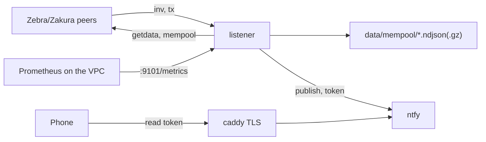

# Mempool listener deployment (draft)

The listener connects to about 50 Zebra and Zakura peers, logs mempool gossip, and sends alerts to a private ntfy server.



## Files

| File | Use |
|---|---|
| `compose.yml` | listener, ntfy, caddy |
| `Dockerfile` | fetches the release binary |
| `mempool.toml` | listener config and rule thresholds |
| `ntfy/server.yml` | deny-all auth, 30-day cache, ntfy.sh upstream for iOS |
| `Caddyfile` | TLS for `alerts.shieldedinfra.net` |

## Set up

1. Copy `.env.example` to `.env`. Set `RELEASE_URL` and `VPC_IP`.
2. Copy a recent `census-*.ndjson.gz` from the crawler into `data/census/`.
3. Start ntfy and caddy: `docker compose up -d ntfy caddy`.
4. Make the users and tokens:

   ```bash
   docker compose exec ntfy ntfy user add listener
   docker compose exec ntfy ntfy access listener mempool write-only
   docker compose exec ntfy ntfy token add listener
   docker compose exec ntfy ntfy user add mark
   docker compose exec ntfy ntfy access mark mempool read-only
   docker compose exec ntfy ntfy token add mark
   ```

5. Put the listener token in `.env` as `NTFY_LISTENER_TOKEN`. Put Mark's token in the ntfy phone app.
6. Start the listener: `docker compose up -d listener`.

## Check

- An anonymous publish fails with 401 or 403: `curl -d hi https://alerts.shieldedinfra.net/mempool`.
- A test alert reaches the phone: `docker compose run --rm listener mempool-listener --config /etc/mempool/mempool.toml --test-alert`.
- Hourly `alive` lines appear in `data/mempool/mempool-YYYYMMDD.ndjson`.

## Events

One line per event in `mempool-YYYYMMDD.ndjson`, with `t` (unix seconds) and `event`:

| Event | Meaning |
|---|---|
| `peer_up`, `peer_down` | a peer finished its handshake, or dropped |
| `seen` | a peer announced a tx by gossip, or a snapshot showed a new tx |
| `snapshot` | a peer answered `mempool` with `count` ids |
| `tx` | a fetched tx: counts, ZIP 317 actions, fee (null with transparent inputs) |
| `tx_undecoded` | zebra-chain could not parse a tx; the raw file keeps its bytes |
| `gone` | no peer listed the tx for 10 min (mined or evicted) |
| `alert` | a rule fired |
| `alive`, `stop` | hourly counts, and the counts at shutdown |

`raw-YYYYMMDD.ndjson.gz` holds `{"wtxid","hex"}` per fetched tx. Each line is its own gzip member, so `gzcat` reads it after a crash.

Replay a day through the rules: `mempool-listener --config mempool.toml --replay mempool-YYYYMMDD.ndjson`.
