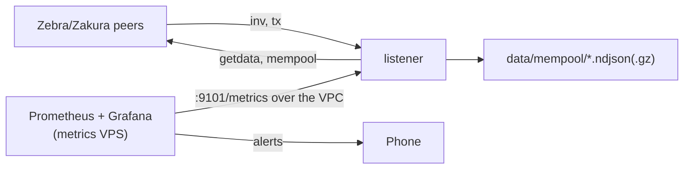

# Mempool listener deployment

The listener connects to about 50 Zebra and Zakura peers, logs mempool gossip, and exports Prometheus metrics. Grafana on the metrics VPS alerts on them.

## Files

| File | Use |
|---|---|
| `compose.yml` | the listener service |
| `Dockerfile` | fetches the release binary |
| `mempool.toml` | listener config and per-tx rule thresholds |

The Grafana alert rules and the Prometheus scrape job live in `ShieldedLabs/shielded-infra` (`workspaces/mempool/README.md`).

## Set up

1. Copy `.env.example` to `.env`. Set `RELEASE_URL` and `VPC_IP`.
2. Copy a recent `census-*.ndjson.gz` from the crawler into `data/census/`.
3. Start the listener: `docker compose up -d`.
4. Check the metrics from the metrics VPS: `curl http://<VPC_IP>:9101/metrics`.

## Alerts

| Alert | Where it runs | Fires when |
|---|---|---|
| Burst | listener | 5+ txs of one shape in 10 min, over 3x the shape's usual rate |
| Under floor | listener | 3+ txs in 10 min pay under 1,000 zats per ZIP 317 action |
| Large tx | listener | a tx is over 100 KB |
| Depth, bytes | Grafana | the mempool is over 3x its 24 h median |
| Few peers, quiet, down | Grafana | under 10 peers, no new tx for 30 min, or no scrape |

The listener counts its alerts in `mempool_alerts_total{rule}`, and Grafana alerts on that counter. The txids and shapes are in the `alert` events.

## Metrics

| Metric | Meaning |
|---|---|
| `mempool_peers_connected` | peers past the handshake |
| `mempool_txs_seen_total` | txs seen for the first time |
| `mempool_txs_fetched_total`, `mempool_txs_undecoded_total` | txs fetched, and those zebra-chain could not parse |
| `mempool_txs_live` | txs seen in the last 10 min |
| `mempool_snapshot_median`, `mempool_live_bytes` | median peer mempool count, bytes of fetched live txs |
| `mempool_alerts_total{rule}` | per-tx rule alerts |

## Events

One line per event in `mempool-YYYYMMDD.ndjson`, with `t` (unix seconds) and `event`:

| Event | Meaning |
|---|---|
| `peer_up`, `peer_down` | a peer finished its handshake, or dropped |
| `seen` | a peer announced a tx by gossip, or a snapshot showed a new tx |
| `snapshot` | a peer answered `mempool` with `count` ids |
| `tx` | a fetched tx: counts, ZIP 317 actions, fee (null with transparent inputs) |
| `tx_undecoded` | zebra-chain could not parse a tx; the raw file keeps its bytes |
| `gone` | no peer listed the tx for 10 min (mined or evicted) |
| `alert` | a per-tx rule fired |
| `alive`, `stop` | hourly counts, and the counts at shutdown |

`raw-YYYYMMDD.ndjson.gz` holds `{"wtxid","hex"}` per fetched tx. Each line is its own gzip member, so `gzcat` reads it after a crash.

Replay a day through the per-tx rules: `mempool-listener --config mempool.toml --replay mempool-YYYYMMDD.ndjson`.
